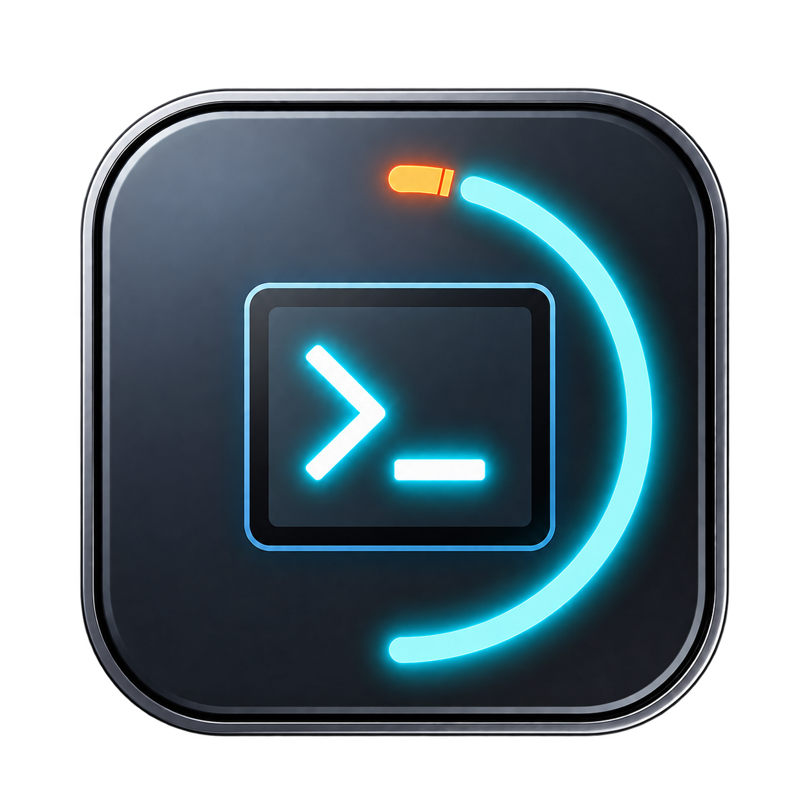
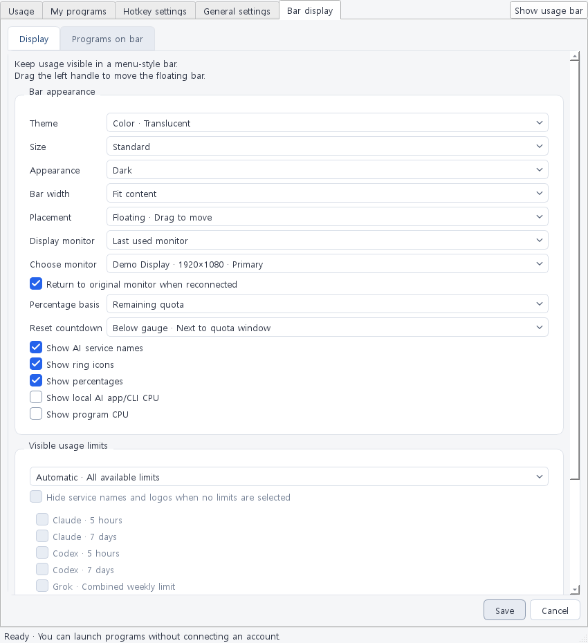
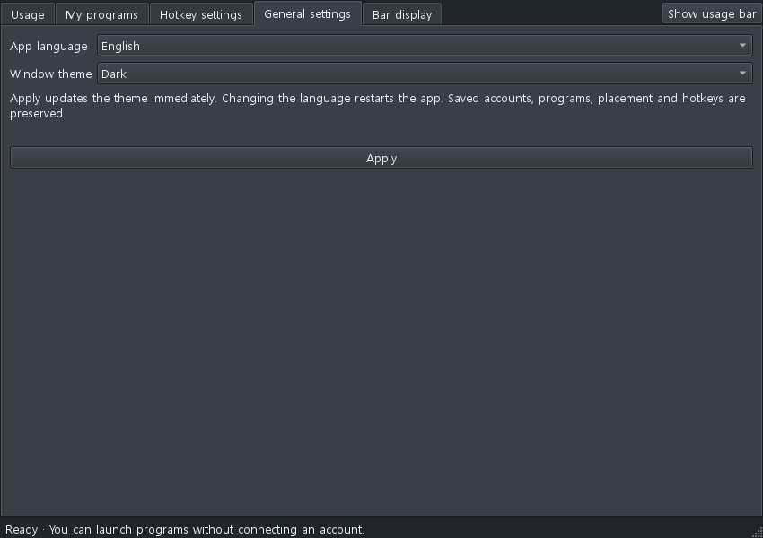
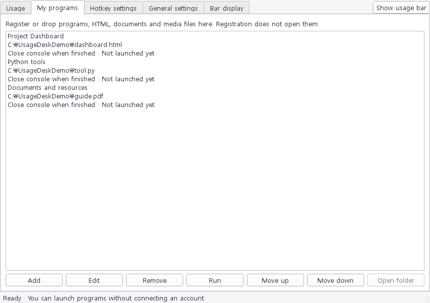
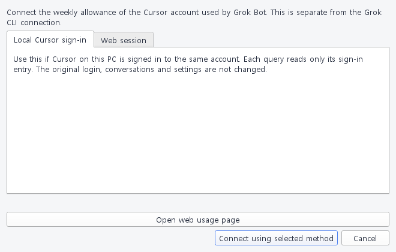
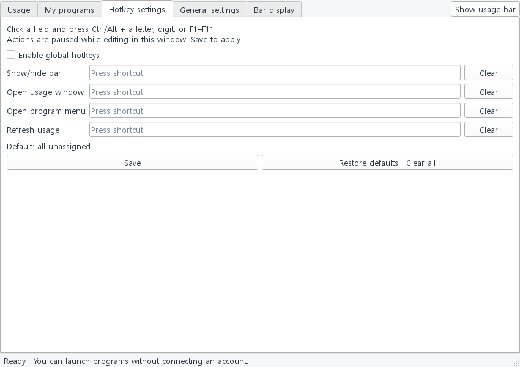
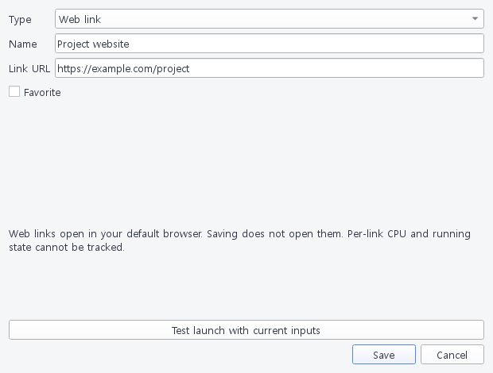

[한국어](README.md) | [**English**](README.en.md)

<p align="center">
  
</p>

# UsageDesk

**AI usage limits and your favorite programs and files, in one Windows toolbar.**

UsageDesk is a Windows desktop utility that shows Claude, Codex, Grok, Grok Bot and Antigravity usage and reset times, and opens programs, HTML pages and documents from the same bar.

Windows 11 · Python 3.13 · PySide6 · **0.1.0a26 / Alpha** · [MIT](LICENSE)


> Screenshots show real application widgets with **synthetic example data**. They contain no real account usage, personal file paths or credentials. Percentages show remaining quota.
>
> The application supports Korean and English. These screenshots show the English UI. Native Windows file pickers and messages follow your Windows language.

## Features

- **Five services in one place** — View limits for Claude, Codex associated with a ChatGPT account, Grok CLI, Grok Bot web accounts and Antigravity.
- **Used or remaining quota** — Switch both percentages and rings together.
- **Time until reset** — Separate the quota window from the countdown, for example `7d │ Reset 23hr 44min`. Hover for the exact reset date, time and fetch status.
- **Floating, top-docked, bottom-docked or tray-only** — Drag the floating bar, reserve desktop work area with a docked bar, or keep only the tray icon.
- **Move between monitors** — Right-click the bar or use `⋯ → Move to monitor` to move without disabling docking. Restore the selected monitor on the next launch.
- **Launch programs and files** — Register EXE, BAT and Python scripts, HTML pages, PDFs, documents and images.
- **Two-line program names** — Adjust spacing and font size, use spare width, then put overflow items in a `+N` menu.
- **Display preferences** — Choose size, colors, light/dark appearance, visible quotas and programs.

Inspired by [Usage4Claude](https://github.com/f-is-h/Usage4Claude), this is an independent Windows application written in Python/Qt. It is not an official Windows port and is not affiliated with Anthropic, OpenAI or xAI.

## Screenshots

### 0.1.0a26 service icon display

Turn off **Settings → Bar display → Display → Bar appearance → Show AI service names** to hide service names while keeping icons and gauges. Hover over an icon for its service name and status. Enabled CPU readings appear below the icon. Program names and quota model-group labels remain visible. Existing settings default to showing names.


Unchecking quotas and hiding an entire service are separate options. In **Custom** mode, enable **Hide service names and logos when no limits are selected** to remove that service's name, icon and CPU area. When disabled, only its gauges disappear. Press **Save** to apply changes.

### 0.1.0a24 monitor selection and restoration

- Right-click the bar or use **⋯ → Move to monitor** to select a connected display. Top/bottom docking and size are preserved, and the old monitor's work area is released. In tray-only mode, selection changes the restore destination while keeping the bar hidden.
- Under **Settings → Bar display → Display → Display monitor**, choose **Last used monitor / Always use primary monitor / Selected monitor**. The quick-move menu selects a specific monitor; dragging the floating bar remembers its destination as the last used monitor.
- If the preferred monitor is unavailable, the bar uses the primary display. Enable **Return to original monitor when reconnected** to move back on reconnect; disable it to remember the fallback primary display as the new destination.
- Existing settings migrate from saved coordinates. Only a hash of the monitor identity is saved. Drivers that provide neither a serial number nor a Windows device identity fall back to the display name, so a port or display-number change may require selecting the monitor again.

### 0.1.0a18 display improvements

- The settings window opens at up to 960×820 within the screen work area. Bar display Save/Cancel buttons remain fixed below the scrolling content.
- Program names use a font 1pt smaller than the bar and 6px horizontal padding. Crowded layouts reduce padding to 4px, reduce the font one more step, then use the `+N` menu.
- In **Bar display → Display → Bar appearance**, toggle local AI app/CLI CPU and program CPU independently. Both default to off. Samples update about every two seconds on a 0–100% scale normalized to all logical CPUs. This measures local processes, not cloud AI servers.
- AI measurement matches `claude.exe`, `codex.exe`, `grok.exe` and observed descendants. Program measurement covers processes launched and tracked by UsageDesk. Differently named launchers, HTML/documents in shared browsers and inaccessible processes cannot be reliably attributed and show `CPU —`. Short-lived processes may finish between samples.

**Light mode**


**More items — a single-row bar with a `+N` overflow menu**


<details>
<summary><strong>Display settings</strong></summary>
<p></p>
</details>



<details>
<summary><strong>Program and file registration</strong></summary>
<p></p>
</details>

## Getting started

You can run from source or build a **Windows x64 portable alpha**. No public Release has been published yet, and no signed installer is provided. Binary distributions are prepared with an EXE ZIP, a corresponding source ZIP and SHA256 checksums. See the [distribution and licensing guide](DISTRIBUTION.md) (Korean).

Requirements: **Windows 11 x64** and [uv](https://github.com/astral-sh/uv).

Download and extract the repository, or clone it, then open PowerShell in the project directory:

```powershell
.\setup.ps1
.\run.cmd
```

`setup.ps1` installs Python 3.13 and the dependencies locally using `uv.lock`. After setup, you can also double-click `run.cmd`.

If Smart App Control blocks the automatically installed interpreter, keep the security policy enabled and install signed Python 3.13 from python.org, then run `./setup.ps1 -Python 'path to the official python.exe'`. If `.python/official-3.13.15/python.exe` exists in the project, setup prefers it.

Click a gauge to open the details window. Selecting tray-only mode under display settings → placement hides both the bar and the details window, and persists across restarts. Choose `Show usage bar` from the tray menu to restore the previous placement and position, including top/bottom docking. Closing the details window returns to the bar, or leaves the app in the tray when tray-only mode is enabled. To exit completely, choose `⋯ → Exit` on the bar or `Exit` in the tray menu.

```powershell
# Start with the details window visible
.\.venv\Scripts\python.exe -m usagedesk.app --window

# Use a separate settings directory for testing
.\.venv\Scripts\python.exe -m usagedesk.app --data-dir .dev-data
```

## Unified settings, language and service visibility

- Open the gear button or **⋯ → Settings**. Display options, program management, hotkeys and general preferences share one window. Settings actions are grouped below a separator in the menu.
- Under **General settings → Window theme**, choose **System / Light / Dark** and select **Apply**. This controls the settings/details windows separately from the bar appearance.
- Open **General settings → App language**, choose **한국어** or **English**, then select **Apply**. A language change restarts the app; theme-only changes apply immediately. Accounts, registered files, hotkeys and bar placement are preserved. The default is Korean.
- Under **Bar display → Display → Visible usage limits**, choose **Custom selection** and enable **Hide service names and logos when no limits are selected**. Uncheck every limit for a service to remove its gauges, name and logo from the bar. The default keeps service headers visible. Automatic mode is unaffected; hidden services remain accessible in Usage details.
- These are local settings. Changing the language does not rename your programs or paths. Operating-system dialogs retain the Windows language.

## Connecting accounts

**Antigravity · added in 0.1.0a25**

1. Install Antigravity CLI (`agy`) using the [official guide](https://antigravity.google/docs/getting-started) and sign in to the same Google account. The Windows default is `%LOCALAPPDATA%\agy\bin\agy.exe`. Check unified App/IDE/CLI sign-in support for your installed versions.
2. Open `Usage → Antigravity · Google account → Sign in / Reconnect`. If discovery fails, use **Choose agy.exe**, then **Connect current CLI account**.
3. Quota groups and reset times come from the official CLI's `/usage` JSON. Shared Gemini and Claude/GPT groups, plus separate Argon/Neon quotas, appear when supplied. A model name alone never creates a separate quota.
4. Used/remaining quota, hover details, quota selection, service hiding and optional CPU display are supported. Exhausting a group's weekly quota also shows 0% usable remaining on its five-hour gauge; hover preserves the original values. Missing values appear as `—`.

This is separate from Gemini Apps base quotas, authentication-specific Gemini CLI quotas and personal Claude/ChatGPT subscriptions. Purchased AI credits are also distinct from base quotas. UsageDesk does not read or store Google credentials, browser cookies or OAuth tokens. It saves only the CLI path and link preference using DPAPI; the official CLI performs quota queries and authentication renewal. Disconnecting in UsageDesk leaves the CLI signed in. The Antigravity CLI is not bundled.

Schema checks, cancellation and connect/restore/disconnect are tested with synthetic CLI responses. On 2026-11-25, existing sign-in and live quota lookup were also verified on Windows using the Google-signed official CLI 1.5.16. Model access and quota groups depend on the plan and returned response.

**Grok Bot · added in 0.1.0a23**

1. Open `Usage → Grok Bot · Web account → Sign in / Reconnect`.
2. If Cursor on this PC is signed in to the same account as Grok Bot, choose **Local Cursor sign-in**. Only the sign-in entry is read; the database is never copied or changed. Renewed sign-ins are reread on subsequent queries.
3. Otherwise choose **Web session → Open web usage page** and sign in to the same account. Follow the dialog to enter only the browser's `WorkosCursorSessionToken` in the hidden field. Never send the cookie in chat. Windows DPAPI encrypts the stored session; reconnect a new value when it expires.
4. Connecting adds a Grok Bot icon and weekly gauge. Existing used/remaining, reset countdown, hover and limit visibility settings apply. It takes no bar space before connection or after disconnection.

Grok Bot uses a different authentication and usage route from Grok CLI. Unified-plan responses are identified as a **Shared weekly allowance**; the two gauges are never added together. Omitted percentages display `—`. This experimental integration uses a web dashboard endpoint and has not been validated against every account type.

<details>
<summary>Grok Bot connection dialog</summary>

</details>

**Claude / Codex**

1. In the details window's `Usage` tab, select the service's `Sign in / Reconnect`.
2. Select `Start browser sign-in`, then sign in and authorize in your browser.
3. If automatic connection fails, follow the app's instructions to enter the callback URL for the current sign-in attempt. Claude also offers an alternative sign-in flow.

Codex values represent **Codex usage limits associated with your ChatGPT account**, not the remaining message allowance for all regular ChatGPT conversations.

**Grok**

Connect the default personal account of the official [Grok Build CLI](https://github.com/xai-org/grok-build). The default executable path is `%USERPROFILE%\.grok\bin\grok.exe`. Sign in through the connection dialog once, then select `Connect current CLI account`. Subsequent polls refresh credentials within five minutes of expiry. A billing 401 triggers refresh and one retry. The CLI's shared `auth.json.lock` prevents concurrent refreshes. Missing or revoked refresh credentials require sign-in again; UsageDesk detects the changed CLI auth file and resumes polling. Network failures and rate limits retain the existing credentials and retry later.

Grok shows the account's combined usage limit. It does not sum per-conversation token counts or API spending. If a successful response omits usage values, the app retains the last successful snapshot, labels it as previous data, and retries at the normal three-minute interval. Manual refresh becomes available after the standard ten-second cooldown. Missing data is never treated as 0% usage; server rate limits still enforce their required wait.

When Grok supplies only the authenticated billing period, the bar keeps `—` and the reset time. This does not mean 0% or 100% remaining. Details distinguish connected authentication from missing usage. A previous value is retained only for the same period; values from an older period are not carried forward.

These integrations are experimental and depend on each service's authentication and response formats. Service changes, account types or plans may limit authentication or usage retrieval.

## Usage tips

### Quotas and reset times

- Choose used or remaining quota in `Bar display → Display → Percentage basis`.
- Enable `Reset countdown` to show the quota type and countdown on the second line.
- `5h` and `7d` identify the **quota window**; text after the separator is the **time until reset**.
- If the server supplies no reset time, the bar shows `Time unavailable`. After the reported time passes, it shows `Checking reset`.
- Usage is normally fetched about every three minutes. Manual refresh also respects server wait periods. Fetch failures and stale data are explained in the hover tooltip and Usage tab; service names do not show an exclamation mark.

**What if Claude or Codex has exhausted its weekly quota but still has five-hour capacity?**

While the account-wide weekly quota is exhausted, the five-hour gauge is adjusted to **0% subscription quota remaining / 100% exhausted**, with `5h │ Weekly quota exhausted`. The tooltip retains the original server value and explains the adjustment. Normal display resumes when a response reports available weekly quota. Extra-usage activation is indicated separately.

### Custom hotkeys

Open the **Hotkey settings** tab in the details window or select it from the tray menu. All shortcuts are unassigned and disabled by default.

- Assign separate combinations for toggling the bar, opening usage details, opening the program menu and refreshing usage.
- Click an input, press Ctrl or Alt with a letter, digit or F1–F11, then select **Save**. Shift may also be included.
- Duplicate combinations, Windows registration failures or file-write failures preserve the previous configuration. The Windows key and F12 are excluded.
- Actions are suppressed while the hotkey settings window is active or a modal dialog is open. Holding a key does not repeatedly trigger its action.
- Hotkeys work in tray mode and are restored on restart. Toggling the bar preserves its previous placement and position.
- Uncheck `Enable global hotkeys` and save to disable all shortcuts. Individual clearing and a reset-to-defaults option are also available.
- If another application has already registered a combination, registration may fail at startup. The hotkey settings page shows the reason.

<details>
<summary>Hotkey settings screenshot</summary>



</details>

### Registering programs, files and web links

Choose a file under `My programs → Add`, or drag it onto the window. Registration alone does not run it. Choose which entries appear on the bar under `Bar display → Programs on bar`.

For a website, choose **Type → Web link** in the Add/Edit dialog, then enter a name and an `https://...` or `http://...` URL. No working directory or arguments are required. Open saved links from the bar, tray or program list in your default browser. Per-link running state and CPU cannot be tracked. URLs are stored in local settings alongside file paths.

<details>
<summary>View the web link dialog</summary>



</details>

- Executables: `.exe`, `.com`, `.cmd`, `.bat`
- Scripts and tools: `.py`, `.pyw`, `.ps1`, `.jar`, `.vbs`, `.vbe`, `.js`, `.jse`, `.wsf`, `.wsh`, `.msc`, `.hta`, `.ahk`
- Shortcuts: `.lnk`, `.url`, `.appref-ms`
- General files: HTML, PDF, Office documents, text, images, music, video and more. Use `All files` for extensions not listed in the picker.

Python scripts prefer the project's `.venv`. Required interpreters and file associations must be installed on your PC. `.js` files run through Windows Script Host. General files open in their Windows default application.

Long names use up to two lines. When space runs out, the bar **reduces padding → reduces the font by one step → uses spare bar width → moves overflow to `+N`**. Short names remain on one line.

## Privacy and local storage

- Application data is stored in `%LOCALAPPDATA%\UsageDesk`.
- Claude and Codex access/refresh tokens, expiry and account identifier are stored in `secrets/claude.dpapi` and `secrets/codex.dpapi` under that directory, encrypted with Windows DPAPI for the current user. File permissions allow only that user and SYSTEM. Passwords are not stored.
- Grok CLI manages `%USERPROFILE%\.grok\auth.json`. UsageDesk reads it per request and saves only the encrypted link preference in `secrets/grok.dpapi`.
- Program paths and UI preferences live in local settings files, including `config.json`, `display.ini`, `hotkeys.json` and `language.json`. These are excluded from Git and release source archives.
- Grok reads and renews the CLI's current credentials. Refresh tokens are sent only to the official `https://auth.x.ai/oauth2/token` endpoint. Rotated credentials atomically replace the CLI auth file with restricted access permissions. UsageDesk stores only the connection preference in its own vault, not a separate token copy.
- Grok Bot manual web sessions are encrypted in `secrets/grokbot.dpapi`. Local Cursor connections store only the selected source and read one sign-in entry per query; browser cookie databases and Grok Bot conversations/vault are not extracted.
- Requests go directly to the respective service. UsageDesk has no collection server or analytics telemetry.
- Disconnecting removes the local connection. It does not revoke server tokens or sign out of the Grok CLI.

Do not attach tokens, callback URLs, authentication files or screenshots containing personal paths to reports. See [SECURITY.md](SECURITY.md) for details.

## Development and verification

See the [release runbook](RUNBOOK.en.md) for preparation, publication review, GitHub Releases and rollback. A [Korean version](RUNBOOK.md) is also available.

```powershell
.\scripts\test.ps1
.\build.ps1
```

Current validation: **478 automated tests**, Ruff and Windows EXE startup/shutdown checks. Coverage includes switching bar lengths back and forth, preserving reset-time display, top/bottom docking, restoration from tray mode, and registering, editing and opening web links in the default browser. Monitor selection, disconnect and reconnect are covered by automated tests. Bidirectional movement, work-area restoration and restart restoration were also checked on two physical monitors at 150% and 100% scaling. This does not guarantee operation across every account, plan or PC environment.

Build output is written to `dist\0.1.0a26\UsageDesk\`. **Move the entire folder, not just the EXE.** Python/Qt notices and library replacement instructions are included. Run `python scripts/package_release.py` to produce binary and corresponding source ZIPs with checksums. This is an unsigned alpha build.

Regenerate README screenshots with the following command. It uses only an isolated directory and synthetic data:

```powershell
.\.venv\Scripts\python.exe scripts/render_readme.py --language en
```

### Scope and limitations

- Windows only. Top/bottom docking uses a separate AppBar; it does not insert the bar into the existing Windows taskbar.
- UNC paths, network drives, reparse paths and folder registration are not supported.
- Applications opened through file associations may not support process tracking or duplicate-launch prevention.
- Automatic startup, quota alerts, settings import/export, an enterprise proxy settings UI and an installer are not implemented.
- Not every combination of mixed-DPI monitors, full-screen applications and authentication expiration/refresh has been tested in real environments.

## References and acknowledgments

- **[bcharleson/grokbot-usage-cli](https://github.com/bcharleson/grokbot-usage-cli)** — Reference for Grok Bot weekly usage/reset fields and the Cursor session format. MIT notice included.
- **[f-is-h/Usage4Claude](https://github.com/f-is-h/Usage4Claude)** — Reference for the menu-bar monitor concept, Claude/Codex authentication protocols and response models. MIT notice preserved.
- **[xai-org/grok-build](https://github.com/xai-org/grok-build)** — Reference for personal CLI account authentication and the billing response protocol. Apache-2.0 notice included.
- **[lobehub/lobe-icons](https://github.com/lobehub/lobe-icons)** — Source of the Claude, OpenAI and Grok SVG logos. MIT notice included.

Pinned commits, reference files and dependency notices are documented in [THIRD_PARTY_NOTICES.md](THIRD_PARTY_NOTICES.md). Service names and marks belong to their respective owners. Codex uses the OpenAI knot logo, and its values refer to Codex limits.

## License

UsageDesk's own code is provided under the [MIT License](LICENSE). Third-party code, logos and dependencies retain their respective licenses. The app icon was prepared from an AI-generated concept supplied by the project owner, with a transparent background and multiple ICO resolutions.
